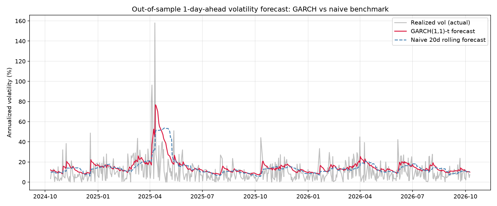
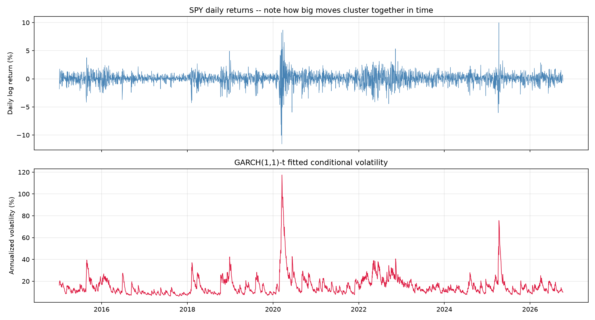
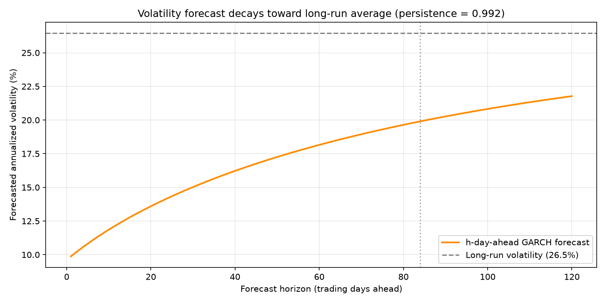

# GARCH-volatility-forecasting

## What is this? 
This project models and forecasts the volatility of S&P 500 (SPY) daily returns using a GARCH(1,1) model, the standard tool for capturing volatility clustering — the empirical fact that large price moves tend to be followed by more large moves, and calm periods tend to stay calm, rather than it being constant like how it is in the Black Scholes model. The model is fit via maximum likelihood, validated with residual diagnostics, and benchmarked out-of-sample against a naive constant-volatility forecast to quantify the actual forecasting edge GARCH provides.

This is the third project in a series exploring increasingly realistic market assumptions: a Monte Carlo option pricer , a pairs-trading strategy, and this project which directly models the fact that volatility itself is not constant.

## How it works?
- Compute log returns — daily log returns are calculated from SPY closing prices (2015–2026), in percent, which is the standard convention for GARCH fitting.
- Fit GARCH(1,1) — the model σ²_t = ω + α·ε²_{t-1} + β·σ²_{t-1} is fit via maximum likelihood (the arch package), first assuming Normally distributed shocks.
- Run diagnostics — standardized residuals are checked for leftover autocorrelation (Ljung-Box test) and for distributional fit (skewness, kurtosis, QQ-plot). Financial returns are well known to have fatter tails than the Normal distribution predicts, so the model is refit assuming a Student's-t distribution for the shocks and compared via log-likelihood/AIC.
- Forecast out-of-sample — a rolling 1-day-ahead forecast is generated across a held-out ~2-year test period (refitting periodically on an expanding window, with the variance recursion updated daily using realized returns in between refits — mirroring how this would actually be used in practice).
- Benchmark against a naive model — the GARCH forecast is compared to realized volatility (actual subsequent squared returns) and to a naive rolling 20-day historical variance forecast, the closest real-world analogue to assuming "recent volatility continues" (i.e. the Black-Scholes constant-volatility mindset).
- Stress-test the result — the comparison is rerun across a grid of refit frequencies (10/20/40 days) and naive window lengths (10/20/60 days) to confirm the GARCH advantage holds broadly rather than depending on one specific configuration.
## The Results
Model fit (Normal errors, full sample): ω = 0.041, α = 0.170, β = 0.795, giving a persistence (α+β) of 0.965 — stationary, with a long-run annualized volatility of ~17.2% and a shock half-life of ~19.5 trading days, closely matching the textbook GARCH behavior described in the project's theoretical writeup.

Diagnostics: The Ljung-Box test on squared standardized residuals passed comfortably (p = 0.18 at 10 lags, p = 0.70 at 20 lags) — confirming GARCH(1,1) successfully captured the volatility clustering, with no leftover structure. However, the residuals showed clear negative skew (-0.71) and excess kurtosis (2.32), rejecting the Normal-errors assumption (Jarque-Bera p < 0.001). Refitting with a Student's-t distribution (estimated degrees of freedom ν = 5.63, indicating genuinely fat tails) improved the model decisively: AIC fell from 7637 to 7439.

Out-of-sample forecasting: Across a held-out ~2-year test period, the GARCH(1,1)-t model outperformed a naive 20-day rolling-volatility benchmark by +3.6% on RMSE and +19.1% on QLIKE (the loss function standard in the volatility-forecasting literature, which penalizes underestimating risk more heavily). The forecast comparison plot shows GARCH reacting almost immediately to a sharp volatility spike in the test period, while the naive benchmark lags visibly behind.

Sensitivity analysis. The comparison was rerun across 9 combinations of refit frequency (10/20/40 days) and naive benchmark window (10/20/60 days). GARCH beat the naive benchmark in 9 out of 9 configurations on both RMSE and QLIKE, with the improvement ranging from +3.0% to +5.5% (RMSE) and +16.8% to +26.1% (QLIKE) — confirming the result is a genuine, robust effect rather than an artifact of one arbitrary parameter choice.

A note on persistence and the Student-t fit. The Student-t model (the better-fitting model per diagnostics) estimates a notably higher persistence (0.992, half-life ≈ 84 days) than the Normal-errors fit (0.965, half-life ≈ 20 days). This is a known sensitivity in GARCH estimation: persistence estimates can be pulled toward 1 by extreme outliers in the training sample — here, the 2020 COVID crash — and is discussed further in Assumptions & Limitations below.

## How to run this code:
- pandas / numpy — data handling and numerical calculations
- arch — GARCH model fitting via maximum likelihood
- statsmodels — Ljung-Box diagnostic test
- scipy — distributional tests (skewness, kurtosis, Jarque-Bera, QQ-plot)
- matplotlib — plotting

## Assumptions & limitations
- Single-asset, single-model-order — only GARCH(1,1) is tested; higher orders (GARCH(2,1), etc.) were not explored, though the clean Ljung-Box result suggests (1,1) is already adequate here
- No leverage effect modeling — plain GARCH treats positive and negative shocks of the same magnitude identically. The negative skew found in diagnostics suggests an asymmetric model (GJR-GARCH or EGARCH) could do better, particularly around sharp downside moves
- Persistence estimate sensitivity — as noted above, the Student-t model's high persistence estimate (0.992) is likely inflated by the 2020 COVID crash in the training sample; a more robust estimation approach (e.g. excluding or down-weighting extreme outliers, or re-estimating on a rolling basis) would likely give a more stable long-run estimate
